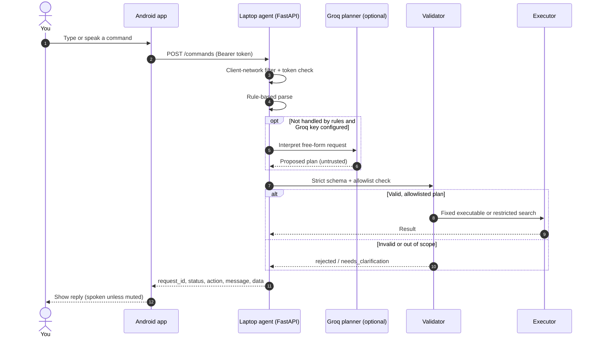
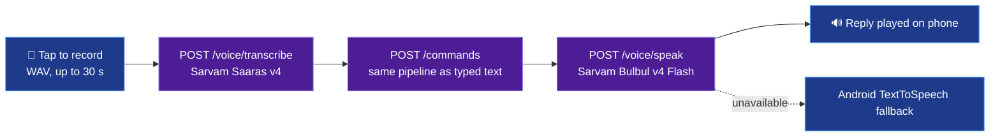
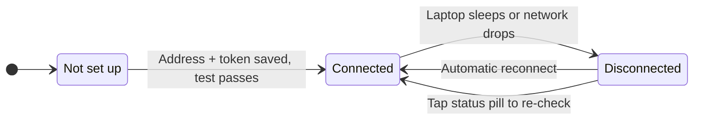
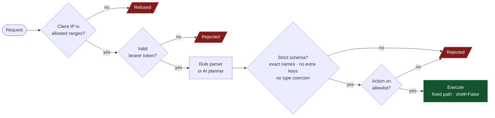

<div align="center">


<br/>

**Speak or type a command on your phone. Your laptop validates it, runs it, and answers back.**
<br/>
The AI may suggest a plan — the laptop agent alone decides what is allowed.

<br/>


[Overview](#overview) · [Architecture](#architecture) · [Security](#security-model) · [Quick start](#quick-start) · [Usage](#usage) · [API](#api-reference) · [Configuration](#configuration) · [Testing](#testing) · [Limitations](#known-limitations)

</div>

---

## Overview

**Vaani** is a voice-first remote operator for a Windows laptop. A native Android app sends typed or spoken commands to a small Python agent running on the laptop. The agent carries out a deliberately short, allowlisted set of actions and returns the result to the phone, optionally spoken aloud.

Requests can be phrased naturally — in **English, Hindi, Telugu, or a mix** — and interpreted by an AI planner. The design principle is simple:

> **The AI proposes. The agent disposes.**
> Every plan is validated against a strict schema and allowlist before anything runs, and no model output ever reaches a shell.

### Highlights

| | Capability | What it means |
|---|---|---|
| 🛡️ | **Allowlisted actions only** | A short, fixed list of actions; programs start from fixed absolute paths with `shell=False`. |
| 🌐 | **Web shortcuts** | Open a Google search or the ChatGPT website in the laptop's default browser. |
| ✅ | **Confirm before opening** | Tap a search result and confirm to open it on the laptop — never from free text. |
| 🔎 | **Restricted file search** | Approved folders only; names and metadata returned, never file contents. |
| 🧠 | **Works without AI** | A rule-based parser covers common commands; Groq planning is optional. |
| 🎙️ | **Multilingual voice** | Sarvam Saaras v4 for speech-to-text, Bulbul v4 Flash for replies. |
| 🔐 | **Secure by default** | Bearer-token auth, client-network filtering, keys never ship in the APK. |
| 🌍 | **Remote access** | Works away from home over Tailscale. |
| ♻️ | **Runs unattended** | Supervisor autostarts at login and self-heals after crashes and network changes. |

---

## Architecture

<div align="center">
  
</div>

### Command lifecycle



### Voice path



### Connection states



---

## Security model

Security is the product's central feature, not an afterthought. Each request must pass every gate; a failure at any point stops the request.



| Layer | Control |
|---|---|
| **Network** | Requests from outside loopback, private LAN and Tailscale ranges are refused. |
| **Authentication** | Bearer token on every endpoint except a minimal `/health`. |
| **Planning** | The AI planner only *suggests*; plans are validated in strict mode before execution. |
| **Execution** | Fixed absolute executable paths, `shell=False`, no model text passed to a shell. |
| **File search** | Approved aliases only; symlinks and junctions not followed; depth, count and time capped. |
| **Query hygiene** | Letters in any script allowed; path separators, drive colons, wildcards, `..` and control characters never. |
| **Secrets** | Live only in `laptop-agent/.env` (git-ignored) or environment variables; never logged. |
| **Audit log** | Records request ID, action and outcome only — not command text or transcripts. |
| **Phone** | Token stored encrypted with an Android Keystore key; API keys never ship in the APK. |

> [!WARNING]
> Do not expose the agent to the public internet. Use home Wi-Fi for testing and Tailscale for remote use. Traffic on home Wi-Fi is plain HTTP.

---

## Supported actions

| Action | Description | Guardrails |
|---|---|---|
| `open_calculator` | Opens Calculator | Fixed absolute path |
| `open_notepad` | Opens Notepad | Fixed absolute path |
| `open_explorer` | Opens File Explorer | Fixed absolute path |
| `find_file` | Searches approved folders by name | Names and metadata (size, modified date) only; capped depth, results and time |
| `get_status` | Reports agent status | Read-only |
| `web_search` | Opens a Google search in the default browser | Query (any language, ≤ 200 chars) is URL-encoded into a fixed `https://www.google.com/search?q=` URL; never placed on a command line |
| `open_chatgpt` | Opens `https://chatgpt.com/` in the default browser | Opens the site only; Vaani does not type or submit prompts |
| `open_file` | Opens a file or folder the user picked from search results | **Only** via `POST /actions` with `confirmed: true` after a confirmation dialog on the phone — never produced by the rule parser or the AI planner. Re-resolved at open time: approved folder only, no symlinks/junctions, must still exist and match the selected result's size and date. Documents, media and archives only; programs, scripts, shortcuts and code files are refused |

Approved folders default to **Documents, Desktop and Downloads**, resolved through Windows Known Folders so OneDrive-redirected folders work.

For browser actions the agent reports that it *asked* the browser to open the page (`page_load_verified: false`); it cannot see whether the page finished loading.

---

## Repository layout

```text
Vaani/
├── laptop-agent/                 Python agent for Windows
│   ├── app/
│   │   ├── main.py               FastAPI app factory and server entry point (python -m app)
│   │   ├── supervisor.py         Background runner (pythonw -m app.supervisor)
│   │   ├── config.py             Settings from environment / .env
│   │   ├── api/                  /commands, /status and /voice endpoints
│   │   ├── models/               Request/response and strict action-plan schemas
│   │   ├── security/             Token auth and client-network filter
│   │   └── services/             Parser, AI planner, executor, file search, Sarvam client
│   ├── scripts/vaani.ps1         start / stop / status / logs and autostart management
│   ├── tests/                    pytest suite (+ opt-in live planner evaluation)
│   ├── requirements.txt
│   └── .env.example
├── android-app/                  Kotlin + Jetpack Compose app (package com.vaani.app)
│   └── app/src/
│       ├── main/java/com/vaani/app/
│       │   ├── data/             Repository interfaces, settings, Keystore token storage
│       │   ├── network/          OkHttp client and address validation
│       │   ├── speech/           WAV recorder and reply playback
│       │   ├── ui/               Compose screens
│       │   └── viewmodel/        Screen state and logic
│       └── test/                 JVM unit tests
├── docs/assets/                  README visuals (animated SVGs)
└── .vscode/                      Build/run/test tasks and workspace settings
```

---

## Quick start

### Prerequisites

<table>
<tr>
<td valign="top" width="50%">

**Laptop**
- Windows 10 or 11
- Python 3.12+ (developed with 3.13)
- *Optional:* [Groq](https://console.groq.com/) API key for AI planning
- *Optional:* [Sarvam AI](https://www.sarvam.ai/) API key for voice
- *Optional:* [Tailscale](https://tailscale.com/) for access away from home

</td>
<td valign="top" width="50%">

**Android build** *(Android Studio not required)*
- JDK 17+ (developed with JDK 25)
- Android SDK command-line tools, platform-tools and the Android 37 platform
  (Gradle downloads missing build tools once SDK licenses are accepted)
- Android 8.0+ phone (minSdk 26) with USB or wireless debugging enabled

</td>
</tr>
</table>

### 1 · Laptop agent

```powershell
cd laptop-agent
py -3.13 -m venv .venv
.venv\Scripts\python.exe -m pip install -r requirements.txt
copy .env.example .env
```

Edit `.env`:

1. Set `VAANI_AUTH_TOKEN` to a random secret of **at least 32 characters**:
   ```powershell
   .venv\Scripts\python.exe -c "import secrets; print(secrets.token_urlsafe(32))"
   ```
2. Set `VAANI_HOST` to the addresses the phone will use (see [Configuration](#configuration)).
3. Optionally add `GROQ_API_KEY` and `SARVAM_API_KEY`.

Start the agent in a terminal:

```powershell
.venv\Scripts\python.exe -m app
```

…or in the background — see [Running in the background](#running-in-the-background).

### 2 · Android app

Point Gradle at your SDK by creating `android-app/local.properties` (git-ignored):

```properties
sdk.dir=C\:\\path\\to\\Android\\Sdk
```

Build and install:

```powershell
cd android-app
.\gradlew.bat assembleDebug
.\gradlew.bat installDebug
```

The APK is written to `android-app/app/build/outputs/apk/debug/app-debug.apk`.

<details>
<summary><b>Prefer VS Code?</b></summary>

**Terminal → Run Task** offers the same steps: *Android: build debug APK*, *Android: install on phone*, *Android: connect over Wi-Fi* and *Android: list devices*. The workspace settings in `.vscode/settings.json` contain example JDK and SDK paths; adjust them to your machine.

</details>

### 3 · Connect the phone

1. Open Vaani. The **Laptop connection** screen appears on first launch (later via ⚙).
2. Enter the laptop address and port — e.g. `192.168.x.x:8765` on home Wi-Fi, or the laptop's Tailscale address (`100.x.y.z:8765`) — and paste `VAANI_AUTH_TOKEN`.
3. Tap **Test connection**, then **Save**.

> [!NOTE]
> Plain HTTP is accepted only for private, Tailscale and loopback addresses. Any other address must use `https://`.

---

## Usage

Type a command, tap a quick-action chip, or tap 🎤, speak, and tap ■ to send. Replies to spoken commands are read aloud unless muted with the speaker icon. The status pill shows **Connected**, **Disconnected** or **Not set up**; tap it to check again.

| Request | Result |
|---|---|
| `Open Calculator` | Calculator opens on the laptop |
| `open notepad, please` | Notepad opens |
| `Find my resume in Desktop` | Matching files and folders from Desktop, with size and date |
| `find the latest pdf in downloads` | PDFs in Downloads, newest first |
| `Is my laptop connected?` | Agent status |
| `google weather in Hyderabad` / `search the web for python tutorials` | Google search opens in the laptop's browser |
| `Open ChatGPT` | ChatGPT website opens in the laptop's browser |
| *Tap a search result → **Open*** | That exact file opens with its default app (or the folder in File Explorer) |
| `calculator kholo` / `कैलकुलेटर खोलो` / `కాలిక్యులేటర్ తెరువు` | Calculator opens *(AI planner)* |
| `delete all files in Documents` | Refused, with an explanation of what Vaani can do |

---

## API reference

| Method | Path | Auth | Purpose |
|---|---|---|---|
| `GET` | `/health` | None | Liveness only |
| `GET` | `/status` | Bearer | Agent version, hostname, AI/voice availability, approved folders |
| `POST` | `/commands` | Bearer | `{"command": "open calculator"}` |
| `POST` | `/actions` | Bearer | Confirmed structured actions, e.g. `{"action": "open_file", "path": "Desktop/notes.pdf", "confirmed": true, "expected_size": 1234, "expected_modified": "…"}` |
| `POST` | `/voice/transcribe` | Bearer | Multipart `file` (WAV, ≤ 2 MB) and optional `language` |
| `POST` | `/voice/speak` | Bearer | `{"text": "...", "language": "en-IN"}` → `audio/wav` |

`/commands` returns `{request_id, status, action, message, data, planner}`.

| `status` | Meaning |
|---|---|
| `success` | The action ran |
| `not_found` | Nothing matched (e.g. a file search with no hits) |
| `rejected` | Refused by validation or policy |
| `error` | The action failed |
| `needs_clarification` | Ambiguous or out-of-scope request; the planner asks a follow-up |

<details>
<summary><b>Example request</b></summary>

```bash
curl -X POST http://<laptop-address>:8765/commands \
  -H "Authorization: Bearer $VAANI_AUTH_TOKEN" \
  -H "Content-Type: application/json" \
  -d '{"command": "open calculator"}'
```

</details>

---

## Configuration

All agent settings are read from environment variables or `laptop-agent/.env` (see [`.env.example`](laptop-agent/.env.example)).

| Variable | Default | Description |
|---|---|---|
| `VAANI_AUTH_TOKEN` | *required* | Shared secret, ≥ 32 characters, sent by the phone as `Authorization: Bearer …` |
| `VAANI_HOST` | `127.0.0.1` | Comma-separated IPs to listen on, e.g. `127.0.0.1,192.168.0.10,100.x.y.z`; addresses not present at start-up are skipped |
| `VAANI_PORT` | `8765` | Listening port |
| `VAANI_ALLOWED_CLIENTS` | loopback, private LAN, Tailscale | Comma-separated CIDRs allowed to reach the agent at all |
| `VAANI_APPROVED_FOLDERS` | `Documents,Desktop,Downloads` | Known folder names or `Alias=C:\absolute\path` entries |
| `VAANI_ENABLE_DOCS` | off | Set to `1` to expose `/docs` (development only) |
| `GROQ_API_KEY` | — | Enables the AI planner |
| `GROQ_MODEL` | `qwen/qwen3.8-27b` | Groq model ID |
| `SARVAM_API_KEY` | — | Enables voice endpoints |
| `SARVAM_STT_MODEL` | `saaras:v4` | Speech-to-text model |
| `SARVAM_TTS_MODEL` | `bulbul:v4-flash` | Text-to-speech model |

> [!IMPORTANT]
> Windows Firewall must allow inbound TCP on `VAANI_PORT` for the Python interpreter running the agent, ideally limited to the local subnet and `100.64.0.0/10`.

### Remote access with Tailscale

1. Install Tailscale on the laptop and the phone and sign in with the same account.
2. Add the laptop's Tailscale IP (`tailscale ip -4`) to `VAANI_HOST` and restart the agent.
3. Use that address in the app. It works on home Wi-Fi and mobile data, and it does not change when the router assigns new local addresses.
4. Consider disabling key expiry for the laptop in the Tailscale admin console.

### Running in the background

```powershell
cd laptop-agent
.\scripts\vaani.ps1 enable-autostart   # start at Windows login (current-user Startup shortcut)
.\scripts\vaani.ps1 start              # also: stop, restart, status, logs
.\scripts\vaani.ps1 disable-autostart
```

The supervisor restarts the agent if it exits, fails three health checks, or the set of available `VAANI_HOST` addresses changes (for example, Tailscale connecting after login or the laptop waking from sleep). Logs are written to `%LOCALAPPDATA%\Vaani\logs`.

---

## Testing

```powershell
# Laptop agent
cd laptop-agent
.venv\Scripts\python.exe -m pytest

# Android app (JVM unit tests)
cd android-app
.\gradlew.bat testDebugUnitTest
```

| Suite | Coverage |
|---|---|
| **Agent** | Authentication, network filter, command parsing, plan validation (including adversarial and malformed AI output), file-search restrictions, web search and ChatGPT URLs, confirmed file opening (traversal, junction escape, duplicates, changed/missing files, blocked file types), voice endpoints, supervisor |
| **Android** | View-model logic, voice flow, reconnection, confirm-before-open flow, HTTP client (against a mock server), formatting helpers |

<details>
<summary><b>Opt-in live planner evaluation</b> (uses API quota)</summary>

Runs 33 real requests — English, Hindi, Telugu, ambiguous, malicious and malformed — through the full pipeline against the Groq model, **without executing anything**.

```powershell
$env:VAANI_LIVE_TESTS = '1'
.venv\Scripts\python.exe -m pytest tests/test_planner_live.py -v
```

</details>

---

## Known limitations

- **No wake-up.** The phone cannot wake a sleeping laptop; the app shows *Disconnected* and reconnects automatically once the laptop is back. Wake-on-LAN is not implemented.
- **Login, not boot.** The agent starts at user login.
- **Locked desktop.** Windows opened while the desktop is locked appear behind the lock screen.
- **Free-tier rate limits.** Groq's free tier allows roughly 8,000 tokens per minute, so bursts of AI-planned commands can briefly report "rate-limited"; rule-based commands are unaffected.
- **Voice depends on the laptop.** Sarvam is called from the laptop, and there is no phone-only speech-recognition fallback yet. Replies are spoken in English (en-IN). Recording works only while the app is open, up to 30 seconds; there is no wake word or locked-screen listening.
- **Intentionally narrow.** Only the actions listed above exist. Files can be opened only after confirming a search result; sending, sharing or deleting files is not supported.
- **ChatGPT prompts.** Vaani opens the ChatGPT website but does not type or submit prompts.
- **Browser actions are unverified.** Vaani confirms the browser was asked to open a page, not that the page loaded or that you are signed in.

---

## Contributing

- Keep both test suites passing and add tests with every change — especially to validation, authentication and file-search code.
- New laptop actions must be added explicitly to the plan schema, the executor and the planner prompt, and must **never** pass user or model text to a shell.
- Never commit `.env`, `local.properties`, API keys or tokens.

---

## License

This repository does not currently include a license file.

<div align="center">
<sub>Built with care for people who would rather talk to their computer than walk to it.</sub>
</div>
